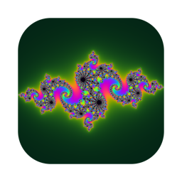

# Visualizers

Audio-visualizers van SamSo.

## SamSo-Fractualizer



Een macOS-app die fractals laat bewegen op de muziek die je Mac afspeelt. Hij luistert naar al het systeemgeluid (Spotify, Apple Music, YouTube, Ableton), dus er is geen loopback-software zoals BlackHole nodig.

- 15 presets: Julia, Mandelbrot-zoom, Burning Ship, Newton, Apollonisch, Koch, oneindige zoom en meer
- Een generator die bij elke klik een compleet nieuwe fractal maakt: vlakke patronen, vloeistof, Lyapunov, tunnels en 3D-vluchten, soms gespiegeld of met feedback
- Negen kleurpaletten, zwart-wit, instelbare gevoeligheid, snelheid en feedback
- Auto-loop door de presets, telkens een nieuwe fractal, of alles willekeurig

### Downloaden en installeren

Download `SamSo-Fractualizer.zip` bij [Releases](../../releases). In de zip zit de app en een handleiding ([Handleiding.html](app/Handleiding.html)) met de stappen voor installeren, de macOS-waarschuwing bij de eerste keer openen en de toestemming voor het geluid.

Vereist macOS 13 of nieuwer, Apple Silicon of Intel.

### Hoe het werkt

| Bestand | Rol |
| --- | --- |
| `index.html` | Alle beelden en de bediening: één WebGL-shader met alle fractals, plus de audio-analyse en het paneel |
| `app/main.swift` | De macOS-schil: een `WKWebView` die `index.html` toont, en ScreenCaptureKit dat het systeemgeluid opvangt en als drie bandniveaus (bas, mid, hoog) doorgeeft |
| `app/build.sh` | Bouwt de universele app en de zip met handleiding |
| `app/icon.swift`, `app/make-icon.sh` | Genereren het app-icoon |

`index.html` werkt ook los in Chrome via een lokale webserver, met tab-audio of een audio-invoer als bron.

### Zelf bouwen

Vereist de Xcode Command Line Tools.

```bash
sh app/build.sh
```

Dit maakt `SamSo-Fractualizer.app` en `SamSo-Fractualizer.zip` in de hoofdmap.

De app is ad-hoc ondertekend. Daardoor vervalt na elke herbouw de toestemming "Scherm- en systeemaudio-opname": verwijder de oude vermelding in Systeeminstellingen en voeg de app opnieuw toe met het plusje. Staat de app in een map met de naam `fractal-visualizer`, dan laadt hij de `index.html` naast de app in plaats van de ingebouwde kopie, zodat je de beelden kunt aanpassen zonder herbouw.
